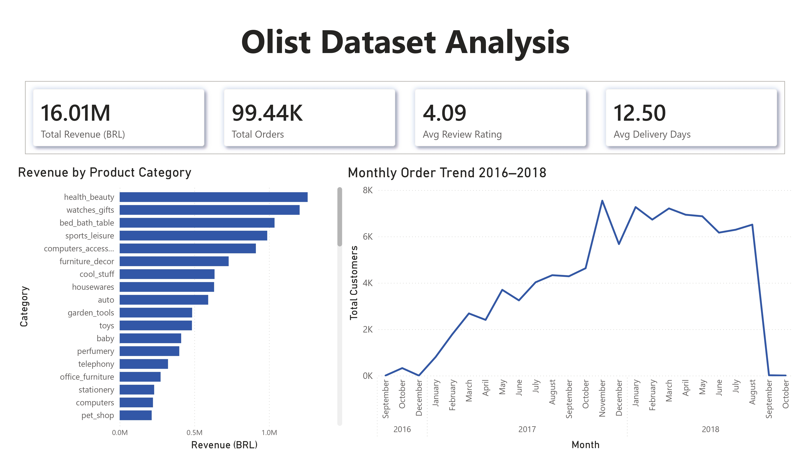
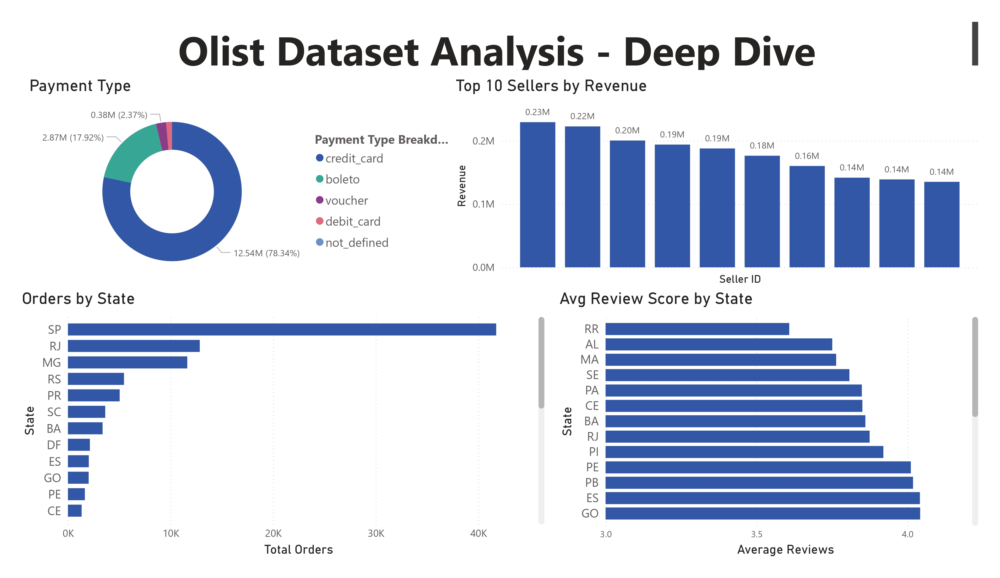
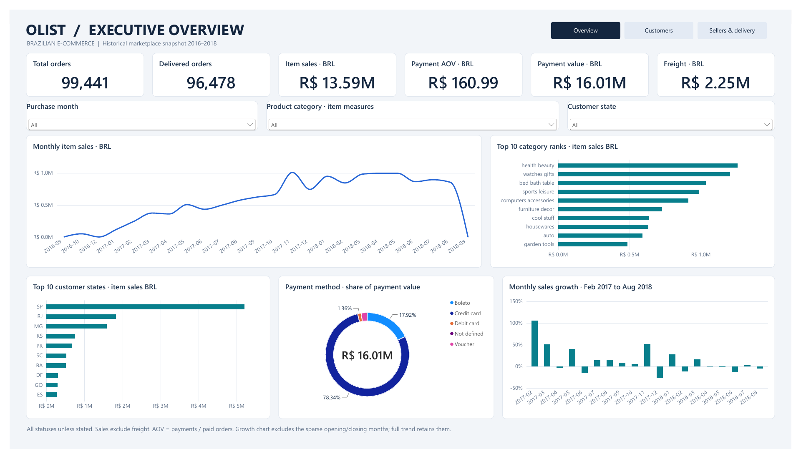
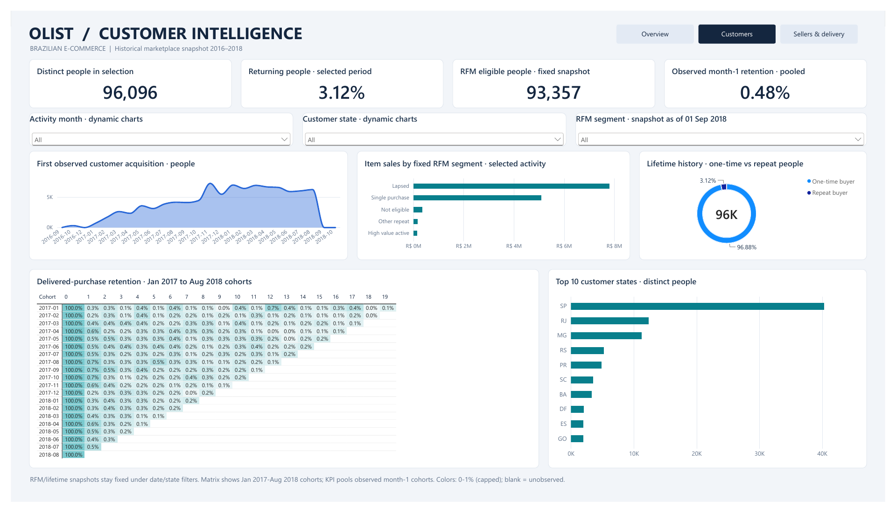
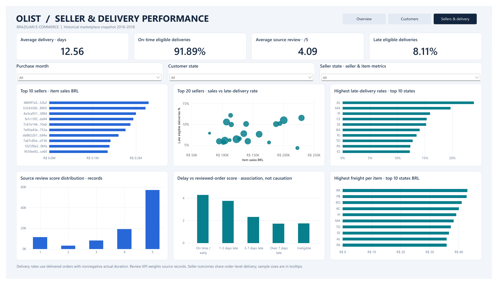

# Olist 2.0 - PostgreSQL Analytics and Power BI Dashboard

An upgrade of my original SQL and Power BI analysis of the Brazilian Olist
marketplace. The project turns nine source datasets into a validated PostgreSQL
reporting layer, advanced business analyses and a three-page Power BI dashboard.

**Stack:** PostgreSQL 18, advanced SQL, Power BI Desktop, DAX, Git.
PostgreSQL handles the analysis and SQL validation. Setup and verification use
SQL files directly through psql or pgAdmin.

**Dashboard status:** completed and validated in Power BI Desktop on 19 October
2026: three pages, 52 measures and **73/73 DAX validation checks passed**.
[Download the PBIX](olist_2_0.pbix) (Git LFS) ·
[View the three-page PDF](Olist_2_0.pdf) ·
[Editable project and validation notes](powerbi/README.md).

**Versions:** the original published project is preserved on
[olist-1.0](https://github.com/PuravDesai004/olist-ecommerce-analysis/tree/olist-1.0);
the current SQL and dashboard release belongs on main, with olist-2.0 retained as the
development branch.

## Business questions

- Which months, categories and regions contribute most to item sales and payments?
- How does repeat buying differ from observed monthly cohort retention?
- Which RFM segments contribute value under a reproducible historical policy?
- Which sellers combine high sales with delivery or satisfaction concerns?
- How do geography, freight, payment methods and delivery delays differ?
- Which financial and source-data anomalies require investigation?

## Verified business findings

The evidence comes from executed PostgreSQL queries in
[olist_queries.sql](olist_queries.sql); query IDs below identify the exact SQL.
The recorded run's timestamps, query hashes, row counts, result samples, legacy
errors and PASS/FAIL gates are retained in
[verification_results.json](sql/verification_results.json).
This historical execution record belongs to release
[2097d69](https://github.com/PuravDesai004/olist-ecommerce-analysis/tree/2097d69dc2926d01ee35d0cba1db44283bdb5714).
Its file hashes refer to that release. Subsequent removal of the Python utilities
and updates to SQL header comments do not represent a new database verification.
The full run on **19 October 2026** passed **119 SQL gates**, executed **38
analyses**, deployed **15 views** and passed the nine-file streaming CSV audit.
Before/after fingerprints confirmed unchanged source tables and CSV files.

Unless a finding specifies otherwise, its population is all source orders/items
across **2016-09-04 to 2018-10-17**, including non-delivered statuses.
Money is historical nominal BRL. Item sales, freight and payments are different
measures; none represents profit.

| Finding and actual result | Definition / SQL evidence | Interpretation and justified action |
| --- | --- | --- |
| November 2017 generated BRL **1,010,271.37** in item sales, **52.10%** above October's BRL 664,219.43. | Q15/Q23; purchase-month item price sums, all statuses; previous calendar-month denominator. Largest monthly item-sales total in the main Jan 2017-Aug 2018 activity window. | Plan capacity around observed peaks and test seasonal hypotheses. The SQL does not prove what caused the increase; sparse closing source months are not evidence of a business collapse. |
| Health & beauty led category item sales at BRL **1,258,681.34**, **9.26%** of all item sales. The top **18** category groups reached **81.20%** cumulatively. | Q09/Q28; source category groups including missing/untranslated labels; all 112,650 item rows; ordered exact sums and the category crossing 80%. | Concentrate category monitoring on the largest contributors while retaining the long tail. This is measured concentration, not an assumed exact 80/20 rule. |
| **2,997 / 96,096 people (3.12%)** placed multiple orders. They represented 6,342 orders and BRL 944,022.71 in payments. | Q14/Q26; customer_unique_id, all statuses and the full snapshot; orders counted once. | Test retention initiatives on clearly defined cohorts before assuming strong repeat demand. This marketplace sample does not observe all of a person's purchases elsewhere. |
| Month-1 activity was **420 / 86,950 (0.48%)** across 19 observed Jan 2017-Jul 2018 cohorts. | Q31; cohort-size-weighted ratio of the executed month_offset=1 cells; first observed delivered-purchase cohort; activity before 2018-09-01. Recent unobserved cells omitted. | Separate same-month repeat orders from later-month retention. Use incremental experiments and consistent observation windows; do not interpret an unobserved future month as zero. |
| The fixed RFM policy identified **500 High value active** people, with BRL **183,407.56**, **1.19%** of eligible payments. | Q21/Q32; delivered-snapshot orders with payment records purchased before 2018-09-01; monetary contribution denominator is the same eligible population. | A small, explicit group can support a measured service/retention pilot. Scores and labels are descriptive policies, not predictions or causal customer-value estimates. |
| **7,826 / 96,470 eligible deliveries (8.11%)** were late. Early deliveries averaged **4.29** per reviewed order; deliveries over seven days late averaged **1.73**. | Q20/Q27; eligible delivered orders have nonnegative actual duration. Review means equally weight 88,163 early reviewed orders versus 3,252 reviewed orders over seven days late. | Prioritize delivery reliability investigation and proactive customer communication. This association does not establish that delay alone caused a low score. |
| Alagoas had **95 / 397 late eligible deliveries (23.93%)**, versus the overall **8.11%**. | Q18; customer-state geography, strict actual > estimate, same eligible-delivery policy. | Review routes, promise windows and operational mix; show sample sizes and investigate confounders before assigning responsibility. |
| Sellers in SP contributed BRL **8,753,396.21** in item sales. The top item-sales seller generated BRL **229,472.63** across **1,132** represented orders, with **11.57%** late among 1,124 eligible deliveries. | Q33/Q34; seller-state item sums; leading seller ID 4869f7a5dfa277a7dca6462dcf3b52b2. Order outcomes shared with participating sellers; no payment allocation. | Monitor concentration and high-volume sellers' service outcomes together. Investigate the logistics chain; shared order-level timestamps cannot isolate seller causation. |
| Credit cards carried BRL **12,542,084.19**, **78.34%** of payment value, but **73.92%** of payment transactions. | Q03/Q36; 76,795 credit-card rows / 103,886 transactions; amount denominator BRL 16,008,872.12. | Track method exposure and installment behavior with separate count and amount denominators. Multiple payments per order make transaction counts unsuitable as order counts. |

The 0.48% pooled retention figure is rounded from SUM(active_customers) /
SUM(cohort_size) over Q31's month-1 rows, not an unweighted mean of percentages.

## KPI definitions and reproduced baselines

| Metric | Result | Population / denominator |
| --- | ---: | --- |
| Orders | 99,441 | All order statuses; one order_id each. |
| Delivered orders | 96,478 | Status equals delivered. |
| Item sales | BRL 13,591,643.70 | SUM(order_items.price), freight excluded, all statuses. |
| Freight | BRL 2,251,909.54 | SUM(order_items.freight_value). |
| Payment value | BRL 16,008,872.12 | Every payment row, all statuses. |
| Payment AOV | BRL 160.99 | Payments / 99,440 orders with at least one payment record, including zero amounts. |
| Average source review score | 4.09 / 5 | Each original review record equally weighted. |
| Average delivery time | 12.56 days | 96,470 delivered orders with actual >= purchase; fractional elapsed days. |
| Late deliveries | 7,826 / 8.11% | Actual strictly after estimate; same eligible-order denominator. |
| Returning people | 2,997 / 3.12% | More than one distinct order / 96,096 customer_unique_id values. |

Q27 provides the executive checks; Q26 supplies the repeat-customer split.
Seller item-subtotal AOV and reviewed-order average scores deliberately have
different definitions from payment AOV and the source-review mean.

## Dataset and local source preservation

Source: [Olist Brazilian E-Commerce on Kaggle](https://www.kaggle.com/datasets/olistbr/brazilian-ecommerce).
Download manually, extract the original CSVs into data/raw/, and keep them local.
Kaggle API credentials are unnecessary.

| Source file | PostgreSQL table | Rows |
| --- | --- | ---: |
| olist_customers_dataset.csv | customers | 99,441 |
| olist_geolocation_dataset.csv | geolocation | 1,000,163 |
| olist_order_items_dataset.csv | order_items | 112,650 |
| olist_order_payments_dataset.csv | order_payments | 103,886 |
| olist_order_reviews_dataset.csv | order_reviews | 99,224 |
| olist_orders_dataset.csv | orders | 99,441 |
| olist_products_dataset.csv | products | 32,951 |
| olist_sellers_dataset.csv | sellers | 3,095 |
| product_category_name_translation.csv | product_category_name_translation | 71 |

Identifiers/ZIP prefixes remain text; money/coordinates use NUMERIC; timestamps
retain the source's timezone-naive values. Original columns are preserved,
including product_name_lenght and product_description_lenght.

## SQL architecture and methods

The public schema holds the nine original source tables.
The project-owned **olist_analytics** schema contains 15 regular reporting views.
The guide documents every view's grain, keys, dimensions, measures and model role.

- **Order, item and payment facts:** independent child aggregation preserves
  one row per order and original item/payment composite keys.
- **Seller-order and category-order facts:** unique participation records.
  Item amounts add correctly; order outcomes are shared across entities.
- **Dimensions:** person, product, seller, source category, customer state and
  contiguous calendar dates.
- **Analytical views:** monthly trends/growth, fixed-date RFM, seller scorecards
  and observed-month cohort retention.

Methods include CTEs, subqueries, conditional aggregation, FILTER, CASE, explicit
date policies, RANK, ROW_NUMBER, NTILE, LAG, LEAD and cumulative windows. Exact
numeric values drive calculations; rounding is deferred to display.

### What changed from the original 29 queries

Every original statement was executed from historical Git revision c113389
against the source schema during the recorded run, and its actual error was
recorded. All 29
needed current field names; the detailed audit remains in the evidence JSON.
Corrections include:

- Payment-row order count inflation and transaction averages mislabeled as AOV.
- Person identity using customer_unique_id and payment pre-aggregation.
- Incomplete translation joins dropping source sales.
- Item/review multiplication and ambiguous category review attribution.
- Fractional delivery duration, nonoverlapping late buckets and matching denominators.
- Fixed historical recency, explicit RFM scores and deterministic ranking ties.
- Calendar gaps, undefined growth and exact monetary ranking before rounding.

B1/B6/I5 are consolidated into Q01 (status counts, shares and delivered flag);
B3/I6 into Q03 (method counts and amount shares). Every other original analysis
is retained with its legacy ID in comments. The result is **38** useful analyses,
including Pareto, first-observed acquisition, purchase gaps, censored cohort
retention, segment contribution, seller scorecards and financial investigation.
Git history retains the original SQL; no duplicate legacy SQL file is necessary.

## Reproduce and verify

Requires a local PostgreSQL service and psql or pgAdmin. The Python utilities
have been removed; run the SQL files manually.

### Existing populated olist2 database

The populated project database already has its reporting views. From this
project folder in PowerShell, run the read-only checks and analyses:

~~~powershell
& 'C:\Program Files\PostgreSQL\18\bin\psql.exe' -X -W -h localhost -p 5432 -U postgres -d olist2 -P pager=off -v ON_ERROR_STOP=1 -f sql/03_validate_import.sql -f sql/04_validate_metrics.sql -f sql/06_validate_analytics.sql -f olist_queries.sql
~~~

Enter the password at psql's hidden prompt. Adjust the executable path if your
installation differs. Alternatively, open each SQL file in pgAdmin's Query Tool
connected to olist2 and execute them in the same order.

SQL errors stop psql because ON_ERROR_STOP is enabled. A returned FAIL row does
not cause a psql error: inspect all **119** rows from 06_validate_analytics.sql
and require PASS for each. Missing rows, NULL results or FAIL results require
investigation. The earlier validation files also display known source anomalies;
compare them with the preserved execution record and data limitations below.

These commands do not recreate views, import source data or update the historical
JSON record. Before manually applying future changes to 05_reporting_views.sql,
inspect existing objects and dependencies in olist_analytics in pgAdmin; the
removed automation's catalog checks no longer run automatically.

### Fresh local reproduction

1. Download the nine CSVs and install/configure PostgreSQL yourself.
2. Create an empty olist2 database manually.
3. Run sql/01_create_tables.sql once against that empty database.
4. In sql/02_import_data.sql, adjust the CSV paths if your checkout differs.
   Run it through psql (its client-side copy commands do not run in pgAdmin).
   It imports only when all nine tables are empty, skips complete counts and
   stops on a partial population.
5. Inspect the olist_analytics schema for existing objects and dependencies.
   For a fresh project database, run sql/05_reporting_views.sql to create the
   reporting layer. Review any existing objects before replacing views.
6. Run the verification command above and review every result.

Do not run the create-tables script on this already populated project database.

### Validation scope

The SQL checks cover source counts/keys/FKs, all view grains and coverage, independent
financial sums, AOV, weighted reviews, monthly growth/running totals, person
identity, RFM eligibility/coverage, raw-data cohort activity, seller/category
rollups, conformed dimensions and preservation of source anomalies.

The historical run additionally compared source-table row counts and
order-independent PostgreSQL row-hash sums, plus CSV SHA-256 hashes, before and
after execution. Its streaming CSV audit and preservation fingerprints are
retained as past evidence; the manual SQL commands do not repeat those file
checks or the historical 29-query audit. SQL assertions and raw reconciliations
check the currently stored data and reporting views.

These historical checks cover the SQL/backend. The additional Desktop model,
DAX and interaction verification is recorded in [powerbi/README.md](powerbi/README.md)
and [the executed DAX summary](powerbi/validation/desktop_final_validation_summary.json).

## Data limitations and analytical cautions

- Historical, partial marketplace coverage; September/October 2018 are sparse
  closing source months. Do not generalize results to today's Brazilian market.
- First observed purchase is not proven first-ever customer acquisition. Low
  repeat/retention rates do not measure all of a person's purchases elsewhere.
- RFM and cohorts use a fixed purchase cutoff and final delivered-status snapshot;
  status history was not supplied.
- customer_unique_id repeats across customer records; review IDs repeat 814 times
  and reviewed order IDs repeat 551 times. All source records remain.
- Geolocation retains 261,831 exact duplicate rows beyond the first, with many
  coordinates per ZIP prefix. Raw ZIP joins can multiply rows.
- Nulls include 610 product categories, 58,247 review messages, 87,656 review
  titles, 160 approvals, 1,783 carrier timestamps and 2,965 actual deliveries.
- **13 product rows** with non-null category lack translations; this is a product
  count, not 13 distinct category labels. Missing ZIP coverage includes 157
  customer and 7 seller prefixes.
- Timestamp anomalies include 1,359 approvals after carrier handoff and 23 carrier
  timestamps after actual delivery. They are preserved and disclosed.
- 98,665 orders have both item and payment records. Of these, 303 differ by over
  BRL 0.01; absolute differences total BRL 3,269.22. There is one item-only and
  775 payment-only orders. The dataset cannot prove the cause of each difference.
- Freight, sales and payments are separate. No cost-of-goods, complete fees or
  profit model is available.
- Shared order outcomes cannot isolate seller/category responsibility. Review
  associations are observational; sample sizes, promise windows and mix matter.

## Repository layout

~~~text
.gitignore
.gitattributes
README.md
POWER_BI_GUIDE.md
olist_queries.sql
overview_page.jpg              # genuine legacy Deep Dive
deep_dive_page.jpg             # genuine legacy Overview
olist_dashboard.pdf           # genuine legacy dashboard export
olist_2_0.pbix                # completed Olist 2.0 dashboard; Git LFS
Olist_2_0.pdf                 # current three-page Desktop export
powerbi/                      # editable PBIP source, previews and validation
data/raw/                     # nine local CSVs; ignored
sql/
  01_create_tables.sql
  02_import_data.sql
  03_validate_import.sql
  04_validate_metrics.sql
  05_reporting_views.sql
  06_validate_analytics.sql
  verification_results.json
~~~

The previously requested learning workbook is preserved locally under ignored
output/. It is a teaching artifact, not the new dashboard. No raw datasets,
password files, environments or caches belong in Git.
The completed olist_2_0.pbix is versioned through Git LFS because it exceeds
GitHub's normal file-size limit. Use the file's Download button or clone with
Git LFS installed to obtain the full report. Desktop caches and backups remain local.

## Original Olist 1.0 dashboard - legacy evidence

These are genuine historical screenshots, not Olist 2.0 visuals. Their displayed
labels and rounded figures follow the original implementation and may differ
from the improved definitions above. Filenames are kept intact.

### Legacy Overview

### Legacy Deep Dive

[Original dashboard PDF export](olist_dashboard.pdf)

## Olist 2.0 dashboard

Open [olist_2_0.pbix](olist_2_0.pbix) in Power BI Desktop to explore the imported
snapshot. Refresh requires the documented local PostgreSQL views and local
authentication. [POWER_BI_GUIDE.md](POWER_BI_GUIDE.md) retains the modeling
contract and learning examples; the current implementation is in powerbi/.

### Executive Overview

### Customer Intelligence

### Seller & Delivery Performance

The previews come from the final Desktop PDF export. Original Olist 1.0 assets
and the olist-1.0 branch remain preserved.

## Author

Purav Desai - B.Tech IT, SCET Surat.
[GitHub](https://github.com/PuravDesai004) |
[LinkedIn](https://www.linkedin.com/in/puravdesai41/)
